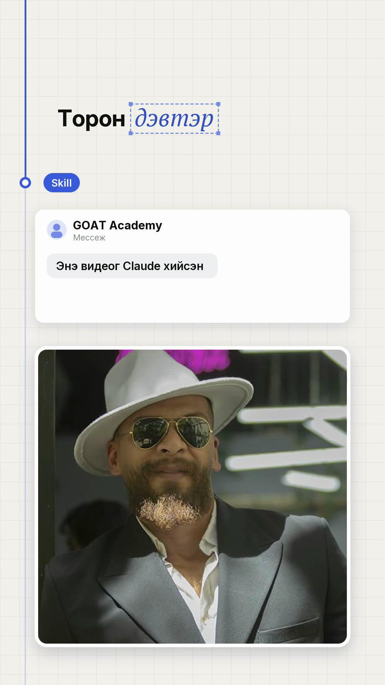

# 🐐 Grid Explainer · Торон дэвтэр

<p align="center"></p>

**Claude Code дотор ажилладаг видео эдитийн skill.** Ярьж байгаа бичлэгийг тайлбар видео болгоно: тортой цагаан цаас, таны нүүр цагаан хүрээтэй картанд, гарчиг, бүлгийн шошго, санаа бүрийг харуулах жижиг апп карт.

Reels, TikTok-д бэлэн 1080×1920 MP4 гаргана. GOAT Academy-гийн 14 эдитийн стилийн нэг.

---

## Юунд тохирох вэ?

- **Тохирно:** коучинг, сургалт, үйлчилгээгээ тайлбарлах, "яаж хийх вэ" бичлэг
- **Тохирохгүй:** зөвхөн дүрс бүхий бичлэг, хурдан хэмнэлтэй зар

---

## Шаардлага

- **Claude Code** (desktop app эсвэл terminal), Claude Pro / Max эрхтэй
- **Mac эсвэл Windows**
- **Node 22+**, **ffmpeg**, Mac дээр **whisper-cpp**. Байхгүй бол Claude өөрөө шалгаад, суулгах командыг хэлж өгнө.
- **Компьютер:** Mac эсвэл 64-bit Windows 10/11. Apple чиптэй Mac (M1+) дээр туршсан. Windows дээр одоогоор туршаагүй.
- Анхны бичлэг дээр ярианы загвар (~1.6 GB) болон кадр зурдаг Chrome-ийн тусдаа хуулбар нэг удаа татагдана. Бүх зүйл таны компьютер дээр ажиллана, юу ч интернэтэд илгээгдэхгүй.

---

## Суулгах

**Хамгийн хялбар:** Claude Code-оо нээгээд энэ мөрийг хуулж бичнэ:
```
Энэ plugin-ийг суулгаад өг: https://github.com/SaagiiSG/goat-grid-explainer
```
Claude өөрөө суулгана. Дараа нь `/reload-plugins` гэж бичих эсвэл Claude Code-оо хаагаад дахин нээнэ.

**Эсвэл өөрөө:** Claude Code дотор энэ 2 мөрийг ээлжлэн бичнэ:
```
/plugin marketplace add SaagiiSG/goat-grid-explainer
/plugin install goat-grid-explainer@goat-grid-explainer
```

**Zip файлаар авсан бол:**
1. `goat-grid-explainer.zip`-ийг задална. Задалсан `goat-grid-explainer` хавтсаа устгалгүй үлдээгээрэй.
2. Claude Code-д "Энэ хавтсан дахь plugin-ийг суулгаад өг:" гэж бичээд задалсан `goat-grid-explainer` хавтсаа чирж оруулна.
3. `/reload-plugins` гэж бичнэ.

---

## Шинэчлэлт

Автомат шинэчлэлт анхандаа унтраалттай байдаг. Бид таны өмнөөс асааж чадахгүй тул нэг удаа өөрөө асаана:
1. Claude Code дотор `/plugin` гэж бичнэ.
2. **Marketplaces** → **goat-grid-explainer** → **Enable auto-update** дээр дарна.

Ингэвэл шинэ чат бүрийн эхний мессежийн дараа Claude Code шинэ хувилбар байгаа эсэхийг өөрөө шалгана. "Plugin updated" гэж гарвал `/reload-plugins` гэж бичнэ.

**Гараар шинэчлэх:** Claude-д "goat-grid-explainer plugin-ийг шинэчил" гэж хэлэхэд болно. Эсвэл terminal дээр энэ 2 мөрийг ээлжлэн бичнэ:
```
claude plugin marketplace update goat-grid-explainer
claude plugin update goat-grid-explainer@goat-grid-explainer
```
Дараа нь Claude Code дотор `/reload-plugins` гэж бичих эсвэл Claude Code-оо хаагаад дахин нээнэ.

**Zip файлаас суулгасан бол** plugin өөрөө шинэчлэгдэхгүй. Шинэ хувилбар авахын тулд дээрх GitHub-ийн аргаар суулгаарай.

> **For Claude Code:** to install this plugin, run `claude plugin marketplace add SaagiiSG/goat-grid-explainer` (or, from an unzipped copy, `claude plugin marketplace add <path to the goat-grid-explainer folder>`) and then `claude plugin install goat-grid-explainer@goat-grid-explainer`, then tell the user to type `/reload-plugins`. To update it: run `claude plugin marketplace update goat-grid-explainer` and then `claude plugin update goat-grid-explainer@goat-grid-explainer`, then tell the user to type `/reload-plugins`. Auto-update is off by default; the user turns it on once in `/plugin` → Marketplaces → goat-grid-explainer → Enable auto-update. A copy installed from an unzipped folder never updates by itself; to get updates, install it from GitHub (`SaagiiSG/goat-grid-explainer`) instead.

---

## Хэрэглэх

1. Видео бүрд **шинэ хоосон хавтас** үүсгэ.
2. Claude Code-ийг тэр хавтсанд нээ.
3. Бичнэ: `/goat-grid-explainer:goat-grid-explainer` эсвэл энгийнээр: **"энэ ярианы бичлэгийг тайлбар видео болгоод өг"**
4. Бичлэгээ чирж оруулаад юу ярьснаа, хэдэн хэсэгт хуваахаа хэлнэ.
5. Claude юу хийхээ товч хэлнэ. Таалагдвал "ок" гэхэд л болно.
6. `output/grid-explainer.mp4` бэлэн. Instagram, TikTok руу шууд оруулна.

---

## Дуу

- **Дуу эффект** автоматаар орно. Кодоор хийсэн учир лицензийн асуудалгүй. Хэрэггүй бол "дуу эффектгүй болго" гэж хэлэхэд болно.
- **Өөрийн дуугаар ярих (voice-over):** утсаараа дуугаа бичээд (voice memo) өгнө. Таны дуу гарах үед бичлэгийн дуу, хөгжим өөрөө намсна.
- **Хөгжим:** Instagram, TikTok апп дотроос нэмбэл зохиогчийн эрхийн асуудалгүй.

---

## Бичлэг хийх зөвлөгөө

- Утсаа нүдний түвшинд барьж, гэрэлтэй газар ярь.
- Цээжнээсээ дээш авч, нүүрээ кадрын дунд байлга.
- Санаа бүрийг тусад нь, тод ярь.

---

Фонтууд нь Google Fonts-оос (OFL лиценз). Лицензийн файлууд `fonts/` хавтсанд байгаа.
